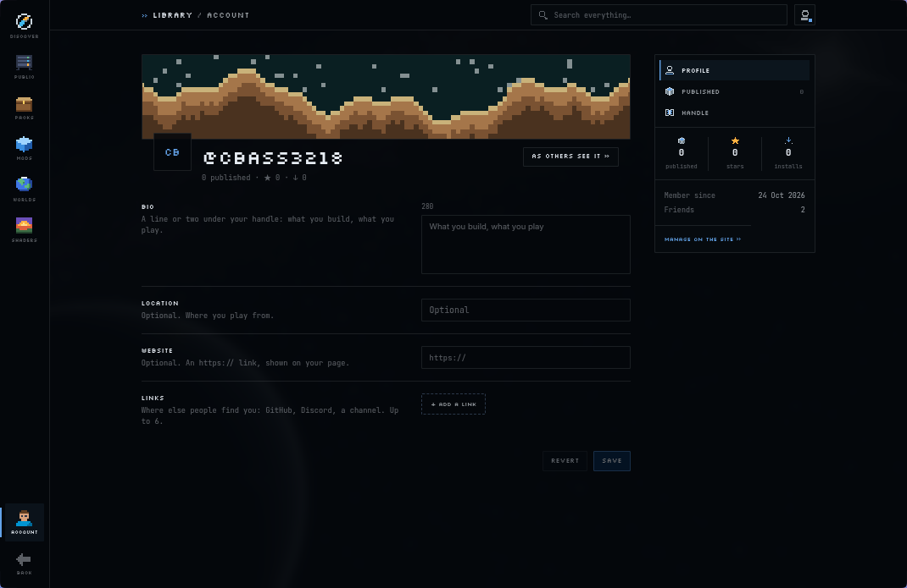

# TODO

> agents do not add to this file. only remove items once completed.

# Movement
- bug: player is able to accelerate toward cursor while in the air if holding shift. after the player has left the floor they should carry on their path unless otherwise acted on.

