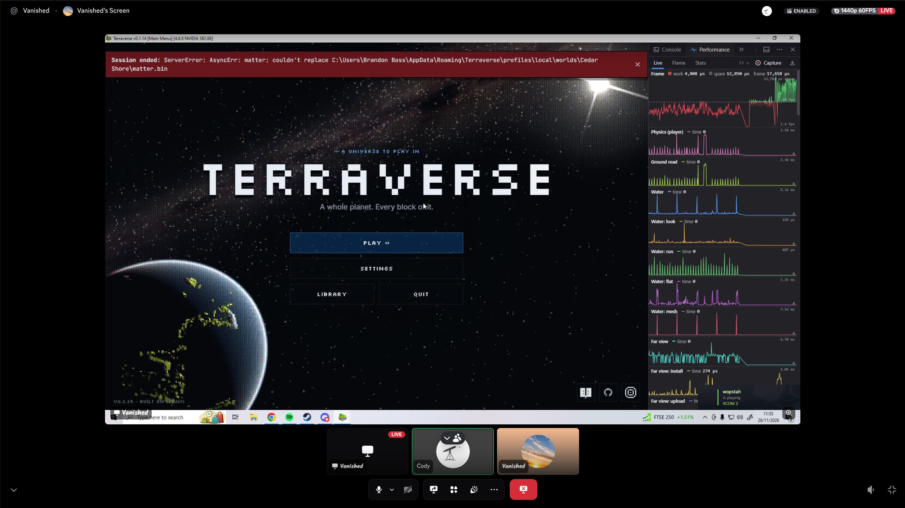
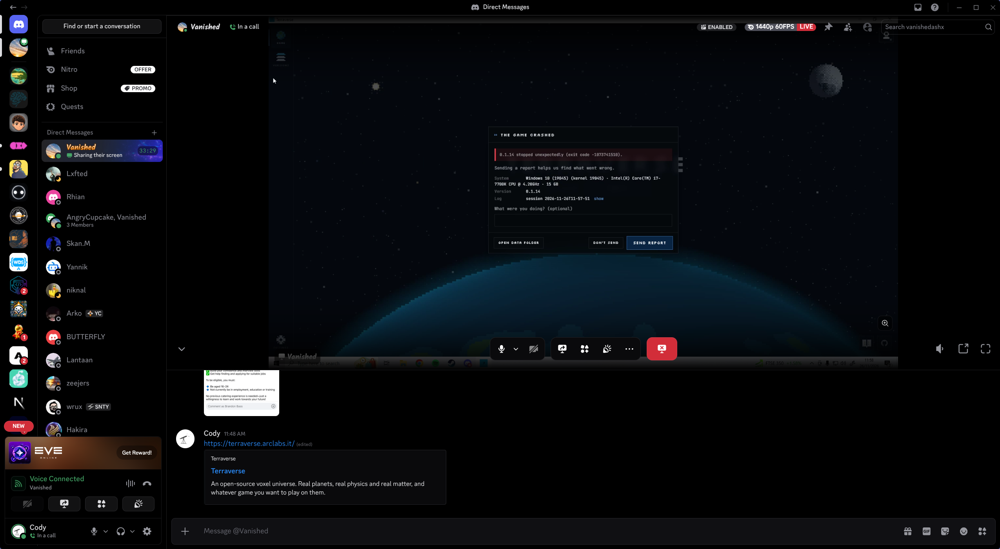
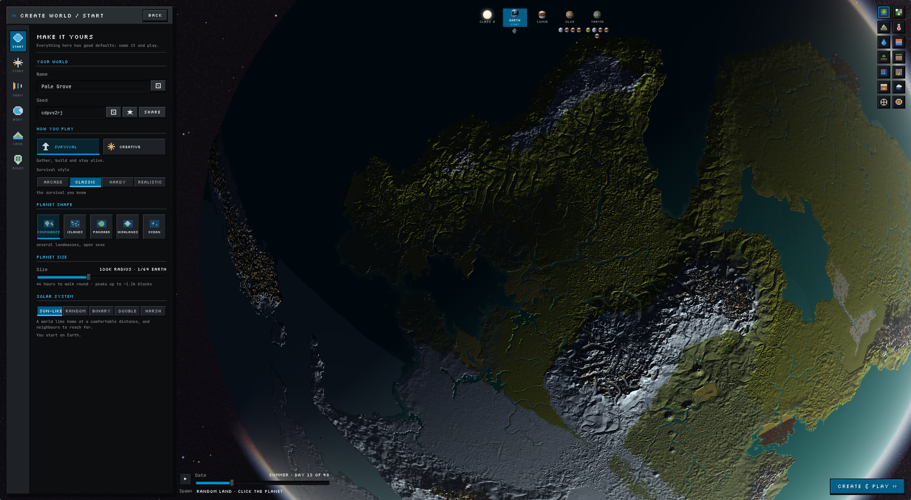

# Terraverse

## Engine Mechanics

### Solar System

A full solar system. Each planet visitable.

### Spherical Worlds

Mutated set of cartesian grids that approximate a sphere.

### Terrain Generation

Realistic geology, weather and water shape the land.

### Global water

Water cycles the globe. Waterfall effects how much water flows down a river, seasons effect flooding. Damming a river valley fills up the valley. Blocking a river makes downstream run dry.

### Advanced player movement

Freerunning, sneaking, parkour, shooting.

### Matter

Everything will be composed of matter. Exact composition determines material behaviour, boiling temperature and strength.

### Fluid Simulation

Local water simulation shows ripples, bouyency and applies forces.

### Matter Simluation

1/16th matter flows. sand flows downhill naturally. explosions send particals everywhere.

### Modding Support

Terraverse provides a rich typescript api for building your own experience.

### Physics

Proper physics applies to all players, machines and vehicle. Orbital mechanics, flight dynamics all come naturally from this. Uses Jolt library under the hood.

### Engineering

Terraverse aims to make vehicles, tools and machines things that are engineerd by the player. Craft parts using specialised benches. Then assemble those parts however you like. How you build, and what you build out of will effect how the piece behaves in the world.

### Agents

Terraverse surfaces built especially for headless agent interaction. Axon agents only for now.